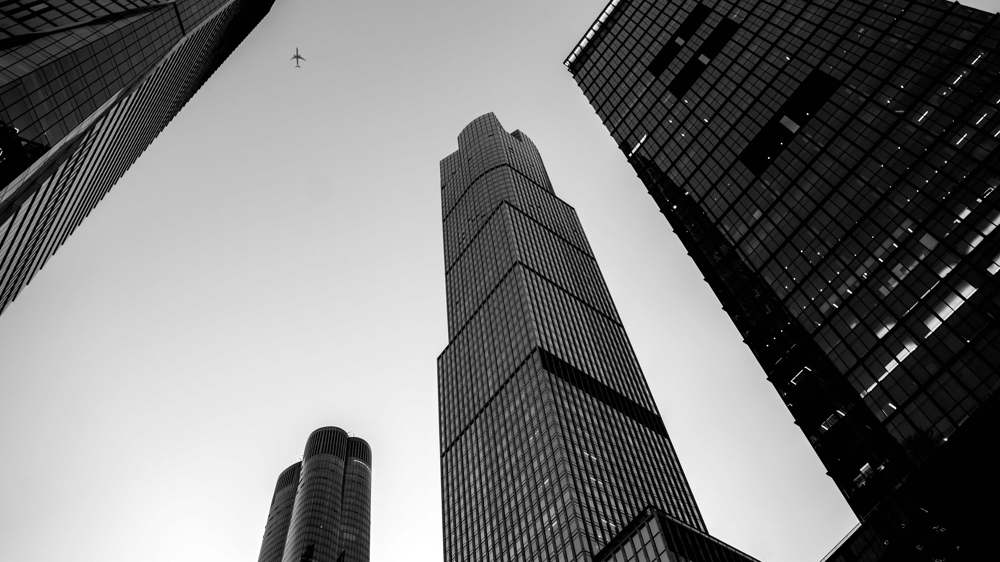

# arch-kde-rice

My Arch Linux + KDE Plasma 6 (Wayland) setup — from the terminal to the wallpaper.



## What's in it

| Part | What I use |
|---|---|
| Desktop | KDE Plasma 6, Wayland |
| Plasma theme | **Desert-Dock** (Desert-Plasma with a macOS-style dock) |
| Window decorations | Orchis (Aurorae), rounded corners via `kwin-effect-rounded-corners` |
| Colors | Orchis / OrchisDark / GraphitePro color schemes |
| Icons | Papirus-Dark |
| Fonts | Inter (UI), JetBrains Mono / Nerd Font (terminal) |
| Panels | Bottom dock (icon tasks) + top bar (clock, tray, lock/logout) |
| KWin effects | Kinetic (fading popups, maximize, scale, squash), Burn-My-Windows Focus & Glide, Slide Up, blur, wobbly windows |
| Alt+Tab | Custom switchers: Clean Glide, Dock Switch, Glass Switch, Thumbnail Grid (Big) |
| Login screen | [SilentSDDM](https://github.com/uiriansan/SilentSDDM) |
| Terminal | Ghostty — black, 75% opacity, Snazzy palette |
| Prompt | Starship (blue powerline) + a custom bash prompt |
| CLI | fastfetch (custom logo), btop, cava, eza, bat, grc |
| Qt / GTK | Kvantum Orchis, Breeze GTK with KDE colors |

## Layout

```
config/            -> ~/.config/
  kde/             -> KDE rc files (kdeglobals, kwinrc, panels, shortcuts...) go straight into ~/.config/
local/share/       -> ~/.local/share/ (color schemes, Aurorae, Plasma themes, KWin effects & switchers)
bash/rice.sh       -> ~/.config/bash/rice.sh (prompt + colored tools, sourced from ~/.bashrc)
wallpapers/        -> ~/.local/share/wallpapers/arch-kde-rice/
sddm/              -> /etc/sddm.conf.d/
```

## Install

```bash
git clone https://github.com/harelhz/arch-kde-rice.git
cd arch-kde-rice
./install.sh --deps --sddm
```

- `--deps` installs the packages with pacman (+ `yay` for the AUR ones).
- `--sddm` installs the login screen config (asks for sudo).
- Anything that would be overwritten is backed up to `~/.rice-backup-<date>/`.

Then log out and back in. If something didn't apply, pick it in System Settings
(Colors, Plasma Style → Desert-Dock, Window Decorations → Orchis, Icons → Papirus-Dark).

### Packages

```
ghostty starship fastfetch btop cava eza bat grc papirus-icon-theme
inter-font ttf-jetbrains-mono ttf-jetbrains-mono-nerd kvantum
AUR: kwin-effect-rounded-corners sddm-silent-theme
```

## Credits

Themes and effects belong to their authors (credits are kept inside each folder):
Orchis by vinceliuice, Desert-Plasma by l4k1, Kinetic effects, Burn-My-Windows by Simon Schneegans,
Papirus by the Papirus team, SilentSDDM by uiriansan. Wallpaper from Unsplash.
