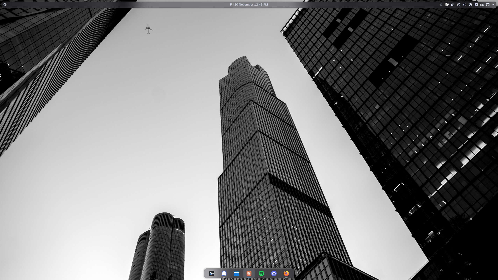
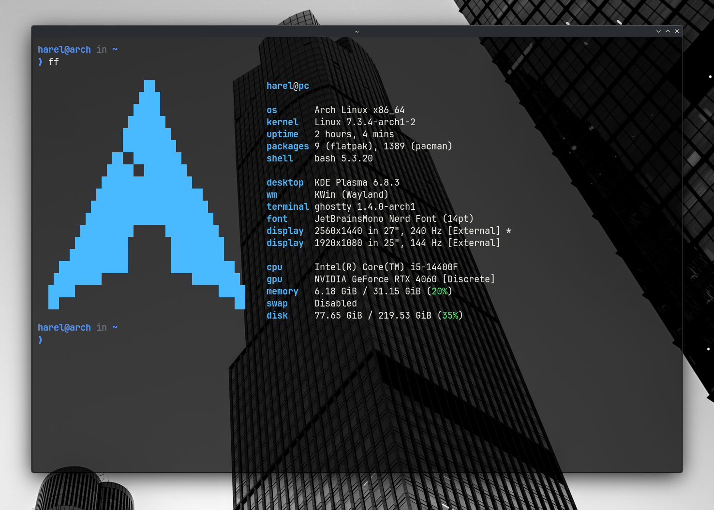
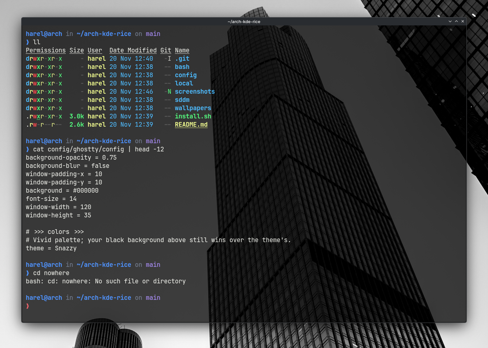
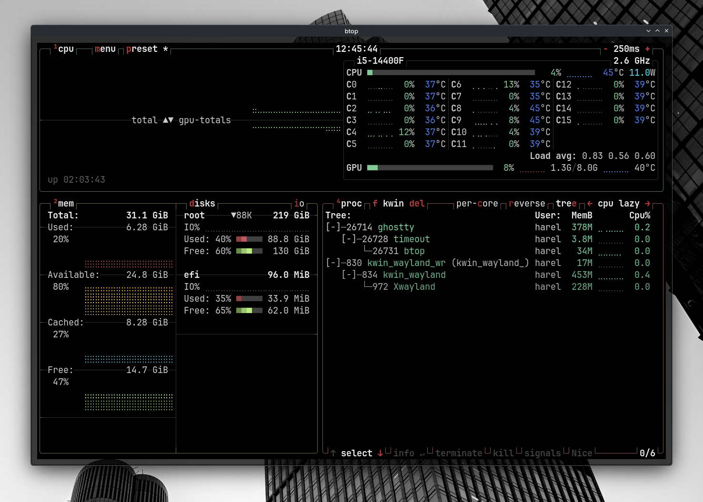
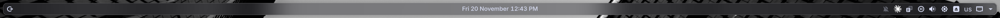
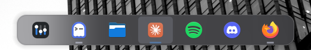
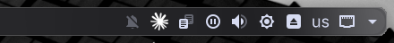
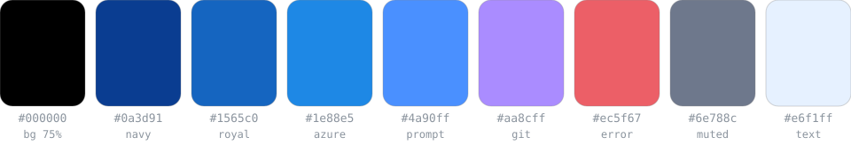

<div align="center">

# 🏙️ arch-kde-rice

**Monochrome city, blue accents, glass everywhere.**
My Arch Linux + KDE Plasma 6 setup — from the terminal to the wallpaper.

[](https://archlinux.org)
[](https://kde.org/plasma-desktop)
[](https://wayland.freedesktop.org)
[](https://ghostty.org)
[](https://starship.rs)



[Screenshots](#-screenshots) · [Highlights](#-highlights) · [Details](#-the-setup) · [Install](#-install) · [Credits](#-credits)

</div>

---

## 📸 Screenshots

<table>
  <tr>
    <td width="50%"></td>
    <td width="50%"></td>
  </tr>
  <tr>
    <td align="center"><b>fastfetch</b> — custom Arch logo in a 75% transparent Ghostty</td>
    <td align="center"><b>the prompt</b> — git branch, eza listing, arrow turns red when a command fails</td>
  </tr>
  <tr>
    <td colspan="2"></td>
  </tr>
  <tr>
    <td colspan="2" align="center"><b>btop</b> — CPU, memory, disks and processes</td>
  </tr>
</table>

### The panels

**Top bar** — centered clock, minimal system tray, floating with rounded ends



<table>
  <tr>
    <td align="center"><b>Dock</b> — Desert-Dock style, running-app indicators</td>
    <td align="center"><b>Tray</b> — monochrome icons</td>
  </tr>
  <tr>
    <td align="center"></td>
    <td align="center"></td>
  </tr>
</table>

---

## ✨ Highlights

- 🪟 **Glass terminal** — Ghostty on pure black at 75% opacity, so the wallpaper shows through, with the Snazzy palette
- ❯ **Two-line prompt** — `user@host in path on branch`, and the arrow turns **red** when the last command failed
- 🎞️ **Kinetic animations** — springy open/close, maximize, squash and fading popups, at 0.5× animation speed for a snappy feel
- 🔀 **Custom Alt+Tab** — four switchers included; **Glass Switch** is the default
- 🔵 **Rounded everything** — rounded window corners via `kwin-effect-rounded-corners`, borderless windows
- 🎨 **Colored CLI** — `eza` for `ls`, `bat` for `cat` and man pages, `grc` for network tools, plus a colorizer for John the Ripper output
- 🔐 **Matching login screen** — SilentSDDM

## 🎨 Palette



---

## 🧩 The setup

| | |
|---|---|
| **OS** | Arch Linux |
| **Desktop** | KDE Plasma 6.8 on Wayland |
| **Plasma style** | Desert-Dock |
| **Window decorations** | Orchis (Aurorae), no borders, rounded corners |
| **Colors** | Orchis · OrchisDark · GraphitePro |
| **Icons** | Papirus-Dark |
| **Cursor** | Breeze |
| **Fonts** | Inter (UI) · JetBrains Mono Nerd Font (terminal) |
| **Terminal** | Ghostty |
| **Shell** | bash with a custom prompt (Starship config included as an alternative) |
| **Fetch** | fastfetch with a custom logo |
| **Monitors** | btop · cava |
| **Qt / GTK** | Kvantum Orchis · Breeze GTK with KDE colors |
| **Login** | SilentSDDM |
| **Wallpaper** | [`wallpapers/wallpaper.jpg`](wallpapers/wallpaper.jpg) |

<details>
<summary><b>⌨️ Keybindings</b></summary>

| Keys | Action |
|---|---|
| <kbd>Alt</kbd> + <kbd>Tab</kbd> / <kbd>Meta</kbd> + <kbd>Tab</kbd> | Glass Switch window switcher |
| <kbd>Meta</kbd> + <kbd>W</kbd> | Overview |
| <kbd>Meta</kbd> + <kbd>G</kbd> | Grid view |
| <kbd>Meta</kbd> + <kbd>D</kbd> | Show desktop |
| <kbd>Meta</kbd> + <kbd>PgUp</kbd> | Maximize window |
| <kbd>Meta</kbd> + <kbd>F1</kbd>…<kbd>F4</kbd> | Switch desktop |
| <kbd>Alt</kbd> + <kbd>F4</kbd> | Close window |

</details>

<details>
<summary><b>🎞️ KWin effects & switchers included</b></summary>

**Effects** (`local/share/kwin/effects`)
- Kinetic: Fading Popups, Maximize, Scale, Squash
- Burn-My-Windows: Focus, Glide
- Slide Up
- Plus built-ins turned on in `kwinrc`: blur, wobbly windows

**Alt+Tab switchers** (`local/share/kwin/tabbox`)
- Glass Switch *(default)*
- Clean Glide (all screens)
- Dock Switch
- Thumbnail Grid (Big)

</details>

<details>
<summary><b>💻 Shell aliases</b></summary>

| Alias | Runs |
|---|---|
| `ff` | `fastfetch` |
| `ls` / `ll` / `la` / `tree` | `eza` with git status and folders first |
| `cat` | `bat --style=plain` |
| `nmap`, `ping`, `dig`, `ss`, `df`… | wrapped in `grc` for color |
| `c` / `e` / `reload` | clear / exit / re-source `.bashrc` |

All in [`bash/rice.sh`](bash/rice.sh).

</details>

<details>
<summary><b>📁 Repo layout</b></summary>

```
arch-kde-rice/
├── config/            → ~/.config/
│   ├── ghostty/       terminal + shader
│   ├── fastfetch/     config + logo
│   ├── btop/ cava/ neofetch/
│   ├── Kvantum/ gtk-3.0/ gtk-4.0/
│   ├── starship.toml
│   └── kde/           kdeglobals, kwinrc, panels, shortcuts… (go straight into ~/.config/)
├── local/share/       → ~/.local/share/
│   ├── plasma/        Desert-Dock, Orchis Plasma + look-and-feel
│   ├── aurorae/       Orchis window decorations
│   ├── color-schemes/
│   └── kwin/          effects + Alt+Tab switchers
├── bash/rice.sh       → ~/.config/bash/rice.sh
├── wallpapers/        → ~/.local/share/wallpapers/arch-kde-rice/
├── sddm/              → /etc/sddm.conf.d/
└── install.sh
```

</details>

---

## 🚀 Install

```bash
git clone https://github.com/harelhz/arch-kde-rice.git
cd arch-kde-rice
./install.sh --deps --sddm
```

| Flag | Does |
|---|---|
| *(none)* | Copies configs, themes, effects and the wallpaper |
| `--deps` | Installs the packages with pacman (+ `yay` for the AUR ones) |
| `--sddm` | Installs the login screen config (asks for sudo) |

Anything that would be overwritten is backed up to `~/.rice-backup-<date>/` first.
Log out and back in afterwards. If something didn't apply, pick it in **System Settings**
(Colors · Plasma Style → Desert-Dock · Window Decorations → Orchis · Icons → Papirus-Dark).

<details>
<summary><b>📦 Packages</b></summary>

```
pacman: ghostty starship fastfetch btop cava eza bat grc papirus-icon-theme
        inter-font ttf-jetbrains-mono ttf-jetbrains-mono-nerd kvantum
AUR:    kwin-effect-rounded-corners sddm-silent-theme
```

</details>

---

## 🙏 Credits

Themes and effects belong to their authors (their credits and licenses are kept inside each folder):
[Orchis](https://github.com/vinceliuice/Orchis-kde) by vinceliuice ·
Desert-Plasma by l4k1 ·
Kinetic effects ·
[Burn-My-Windows](https://github.com/Schneegans/Burn-My-Windows) by Simon Schneegans ·
[Papirus](https://github.com/PapirusDevelopmentTeam/papirus-icon-theme) ·
[SilentSDDM](https://github.com/uiriansan/SilentSDDM) by uiriansan ·
Wallpaper from Unsplash.

<div align="center">

⭐ **If you like it, leave a star!**

</div>
